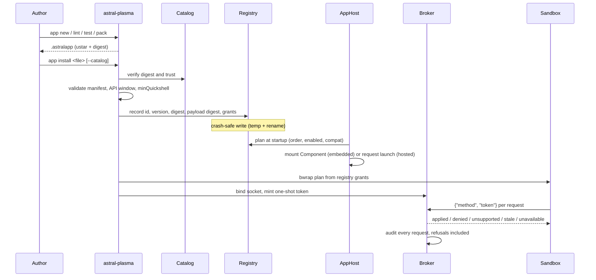

# Astral Plasma — Architecture & Engineering Specification

> Comprehensive architectural reference, design patterns, domain models, and system interactions for **Astral Plasma**.

---

## 1. Executive Summary & Design Vision

**Astral Plasma** is a high-performance, fluid, and multi-compositor desktop shell built with [Quickshell](https://quickshell.outfoxxed.me/) (Qt 6 QML) and a native **Rust daemon**. 

Originally engineered for **KDE Plasma 6 & KWin**, the shell has evolved into a **compositor-neutral desktop environment engine** supporting **Hyprland** and hosted **Omarchy 4.0.x** plugin integration through a strict **Ports-and-Adapters (Hexagonal)** and **Domain-Driven Design (DDD)** architecture.

The design language adapts upstream aesthetic principles from [caelestia-dots/shell](https://github.com/caelestia-dots/shell)—including seamless screen framing, liquid-glass materials, organic concave shoulder fillets, and Material 3 Expressive motion physics—while delivering an extensible, production-grade Linux desktop shell.

---

## 2. High-Level Architecture Overview

Astral Plasma adheres strictly to **Domain-Driven Design (DDD)** and the **Dependency Rule** (all source code dependencies point inwards towards the Domain). Low-level compositor details and protocol objects never cross boundary layers into domain models or UI presentation components.

```
┌─────────────────────────────────────────────────────────────────────────────────┐
│                             PRESENTATION LAYER (QML)                            │
│  shell.qml · UnifiedShell · UnifiedDock · CentralDashboard · Popouts · Overlays │
│                                        │                                        │
│                        DesktopSessionFacade (QML Singleton)                     │
└────────────────────────────────────────┬────────────────────────────────────────┘
                                         │ Quickshell IPC / CLI / Unix Sockets
┌────────────────────────────────────────▼────────────────────────────────────────┐
│                             INTERFACES LAYER (Rust)                             │
│  CLI (bin/astral-plasma) · REST API Server · Unix Socket Event Stream (watch)   │
└────────────────────────────────────────┬────────────────────────────────────────┘
                                         │ Calls Application Use Cases
┌────────────────────────────────────────▼────────────────────────────────────────┐
│                             APPLICATION LAYER (Rust)                            │
│  DesktopSessionCoordinator · WindowControlUseCase · WorkspaceControlUseCase     │
│  PlasmaControlUseCase · ShortcutControlUseCase · WineMprisService · Lifecycle   │
└───────────────────┬─────────────────────────────────────────┬───────────────────┘
                    │ Depends on Domain Ports                 │ Emits Domain Events
┌───────────────────▼─────────────────────────────────────────▼───────────────────┐
│                               DOMAIN LAYER (Rust)                               │
│  Entities & Value Objects: DesktopSessionSnapshot · Output · Workspace · Window │
│  Capability · UserIntent · ActionResult · DesktopEvent · WineMediaInfo          │
│  Domain Ports: DesktopSessionPort · WindowManagerPort · WorkspacePort           │
│  OutputPort · FocusPort · PreviewPort · CompositorEffectsPort · TrayPort        │
└───────────────────────────────────▲─────────────────────────────────────────────┘
                                    │ Implemented By Adapters
┌───────────────────────────────────┴─────────────────────────────────────────────┐
│                            INFRASTRUCTURE LAYER (Rust)                          │
│  DesktopFactory (dynamic & config-driven session / compositor detection)        │
│  KWinAdapter (KWin D-Bus, KWin Scripting, ScreenShot2, Plasma Panel Watchdog)   │
│  HyprlandAdapter (Direct UNIX Domain Sockets: .socket.sock & .socket2.sock)     │
│  ProcMetricsAdapter · TrayAdapter · PipeWire Audio DSP · EmbeddedBundle         │
└─────────────────────────────────────────────────────────────────────────────────┘
```

---

## 3. Layer Responsibilities & Strict Boundaries

### 3.1. Domain Layer (`daemon/src/domain/`)

The Domain layer is the authoritative core of the desktop shell. It contains enterprise business rules, canonical entities, value objects, and domain ports.

**Crucial Invariant:** The Domain layer has **zero dependencies** on external frameworks, I/O libraries, compositor protocols, or other daemon layers (`application/`, `infrastructure/`, `interfaces/`).

Key components:
- **Canonical Ubiquitous Models** (`domain/model.rs`):
  - `DesktopSessionSnapshot`: Immutable, versioned state projection representing displays, workspaces, windows, capabilities, and connection status.
  - `Output`: Display geometry, scale factor, refresh rate, and focus state.
  - `Workspace`: Canonical desktop index, display association, and active status.
  - `Window`: External application window identity, titles, icons, and layout state (`maximized`, `minimized`, `fullscreen`, `floating`).
  - `Capability`: Dynamically queried feature support (`workspaceSwitch`, `backgroundBlur`, `windowPreview`, `globalShortcuts`, `focusRestore`).
  - `UserIntent`: Typed intent request (`focus-workspace`, `activate-window`, `toggle-surface`).
  - `ActionResult`: Typed execution result (`applied`, `pending`, `unsupported`, `unavailable`, `stale`).
  - `DesktopEvent`: Canonical facts emitted during session transitions (`WorkspaceActivated`, `WindowFocused`, `WindowListChanged`, `OutputChanged`).
- **Domain Ports** (`domain/ports.rs`):
  - `DesktopSessionPort`: Query snapshot, capabilities, and execute intents.
  - `WindowManagerPort`: Query, activate, close, or minimize windows.
  - `WorkspacePort`: Query virtual desktops and switch workspaces.
  - `OutputPort`: Enumerate displays and identify focused display.
  - `FocusPort`: Window focus restoration and focus-grab management.
  - `PreviewPort`: Capture live window thumbnail buffers.
  - `CompositorEffectsPort`: Report compositor blur support and modes.
  - `TrayPort`: StatusNotifierItem system tray interactions.

---

### 3.2. Application Layer (`daemon/src/application/`)

The Application layer coordinates domain entities, ports, and external operations to fulfill user tasks. It contains application services, coordinators, and use cases.

Key components:
- **`DesktopSessionCoordinator`**: Coordinates desktop snapshot retrieval, capability validation, and intent execution across active compositor ports.
- **`WindowControlUseCase`**: Orchestrates window focus handoffs, activations, and graceful closures.
- **`WorkspaceControlUseCase`**: Coordinates virtual desktop switching and creation.
- **`PlasmaControlUseCase`**: Manages KDE Plasma panel lifecycle via systemd user units (`plasma-plasmashell.service`) non-destructively, preserving user configs without runtime containment deletion (see [`docs/KDE-INTEGRATION.md`](KDE-INTEGRATION.md)).
- **`ShortcutControlUseCase`**: Granular snapshotting, binding, and restoring of desktop shortcuts.
- **`WineMprisService`**: Bridges non-native Windows applications (e.g., NetEase Cloud Music running under Wine/Proton) to standard Linux MPRIS D-Bus interfaces.
- **`WatchEvents`**: Event dispatching loop listening to system changes and broadcasting updates to the frontend.

---

### 3.3. Infrastructure Layer (`daemon/src/infrastructure/`)

The Infrastructure layer contains all concrete adapter implementations for interacting with operating system facilities, external D-Bus services, hardware devices, and window managers.

Key components:
- **`DesktopFactory`** (`infrastructure/desktop_factory.rs`):
  - Dynamically detects the active compositor (`KWin` vs. `Hyprland`) and environment profile (`Kde`, `Hyprland`, `Omarchy`).
  - Implements configuration precedence: Command-Line Flags > `settings.json` Config Overrides > Runtime Detection.
  - Instantiates the corresponding port implementations.
- **`KWinAdapter`** (`infrastructure/kwin_adapter.rs`):
  - Connects to KWin via D-Bus (`org.kde.KWin`).
  - Executes KWin ECMAScript scripts for window focus and virtual desktop switching.
  - Captures window previews via KWin's `org.kde.KWin.ScreenShot2` D-Bus interface.
- **`HyprlandAdapter`** (`infrastructure/hyprland_adapter.rs`):
  - Direct UNIX Domain Socket streaming via `std::os::unix::net::UnixStream`.
  - Connects to `$XDG_RUNTIME_DIR/hypr/$HYPRLAND_INSTANCE_SIGNATURE/.socket.sock` for zero-overhead JSON requests (`j/workspaces`, `j/clients`, `j/activewindow`, `j/monitors`).
  - Listens to `.socket2.sock` for real-time compositor events (`activewindow>>`, `workspace>>`, `openwindow>>`, `closewindow>>`) without polling loops.
- **`ProcMetricsAdapter`**: High-performance `/proc` filesystem parser providing CPU, memory, IO, and network metrics.
- **`PipeWire Visualizer`**: Direct PipeWire PCM audio capture with fast Fourier transform (DSP FFT) emitting physical spectral energy.
- **`EmbeddedBundle`**: Compiles the entire QML shell theme and Omarchy plugin assets directly into the standalone Rust binary (`bin/astral-plasma`).

---

### 3.4. Interfaces Layer (`daemon/src/interfaces/`)

The Interfaces layer provides entry points into the application for human users, scripts, and external tools.

Key components:
- **CLI (`interfaces/cli.rs`)**:
  - `astral-plasma run`: Launches the full self-contained shell environment.
  - `astral-plasma session snapshot`: Queries canonical session snapshot JSON.
  - `astral-plasma omarchy <install|remove|status>`: Manages hosted Omarchy plugin installation.
  - `astral-plasma doctor`: System readiness and dependency diagnosis.
  - `astral-plasma workspaces`, `shortcuts`, `metrics`, `visualizer`.
- **REST / Socket API Server (`interfaces/api_server.rs`)**:
  - Serves an embedded HTTP and Unix domain socket API for external widgets and script integration.

---

### 3.5. Presentation Layer (QML / Quickshell)

The frontend is built using **Quickshell** and **Qt Quick / QML**.

```
shell.qml                         # Root entry point, IPC handlers, screen scopes
shell/UnifiedShell.qml            # Core unified desktop surface & frame
modules/Astral/Kernel/            # Kernel: shared singletons + primitives
├── theme/                        # Theme.qml, Colors.qml, archetypes, assets
├── components/                   # LiquidGlassCard, CornerFillet, MaterialIcon, motion/
├── config/Config.qml             # Reactive settings singleton
└── services/
    ├── DesktopSessionFacade.qml  # Canonical QML facade singleton
    ├── WindowService.qml         # Window list and active window state
    ├── KWinWorkspaces.qml        # Virtual desktops & workspace state
    ├── MprisMedia.qml            # MPRIS media player arbitration
    └── NetworkService.qml        # Network and Wi-Fi state
dock/
├── LeftDock.qml                  # Capsule dock container
├── components/                   # Launcher, Taskbar, Clock, StatusIcons, Tray
└── popouts/                      # FusedBottomPopout (Audio, Battery, Network, etc.)
dashboard/
├── CentralDashboard.qml          # Dropdown dashboard overlay
└── tabs/                         # Dashboard, Media, Performance, Workspaces, AI
settings_gui/                     # In-shell Nexus Settings Hub
omarchy/                          # Hosted Omarchy plugin package
├── manifest.json
├── Service.qml
└── Bar.qml
```

Feature directories import the kernel by path for now
(`import "../../modules/Astral/Kernel/theme"`). The `Astral.Kernel 1.0` module
URI lands in P2 of [`APPS-PLATFORM-SPEC.md`](APPS-PLATFORM-SPEC.md): importing a
`qmldir` module compiles its singletons eagerly, and the kernel's singletons
import `Quickshell`, which the `qml6` test runner cannot load (Appendix C.6).

- **`DesktopSessionFacade.qml`**: Central singleton acting as the QML presentation facade. It mirrors the canonical `DesktopSessionSnapshot`, checks `capabilities`, tracks `connection` health (`connected`, `degraded`, `disconnected`), and updates reactively without hardcoded compositor checks.
- **Zero-Overlap Partitioning**: Panels and frames are mathematically partitioned to eliminate dark seam artifacts caused by stacked semi-translucent fills.
- **Concave Shoulder Fillets** (`modules/Astral/Kernel/components/CornerFillet.qml`): $C^1$-continuous inverted corner fillets blending vertical panels smoothly into the outer desktop frame.
- **Liquid Motion Physics**: All spatial transitions use Material 3 Expressive beziers with decoupled leading/trailing edge durations (500ms/750ms).

---

## 4. Multi-Compositor & Session Engine

Astral Plasma runs seamlessly across multiple Wayland compositors:

### 4.1. KDE Plasma 6 & KWin (`KdeProfile`)
- **Panel Takeover**: Safely disables KDE Plasma panels via D-Bus on startup and automatically restores original panels on exit.
- **Watchdog Protection**: If the shell process terminates unexpectedly, a detached supervisor watchdog restores the KDE panels immediately.
- **Shortcuts**: Hooks bare `Meta` and global shortcuts through KWin script packages and `KGlobalAccel`.

### 4.2. Hyprland Standalone (`HyprlandProfile`)
- **Direct IPC Socket Stream**: Communicates directly over UNIX domain sockets (`.socket.sock` and `.socket2.sock`) with zero child-process overhead.
- **Dynamic & Persistent Workspaces**: Supports Hyprland's dynamic on-demand workspace creation as well as persistent workspaces (`workspace = X, persistent:true`).
- **Layer-Shell Surface Management**: Manages Quickshell `PanelWindow` layer-shell surfaces with blur rules. The AI Copilot is a real xdg-toplevel (`FloatingWindow`) instead, so the compositor's window list and task switcher can reach it; the KWin profile installs the matching frameless window rule.

### 4.3. Hosted Omarchy Plugin (`HostedOmarchyProfile`)
- **Single Host Rule**: In an Omarchy environment, `omarchy-shell` is the sole Quickshell host process. Astral Plasma integrates as a plugin rather than spawning a competing root shell.
- **Plugin Manifest & Entry Points**:
  - `manifest.json`: Versioned plugin descriptor conforming to `schemaVersion: 1`.
  - `Service.qml`: Exposes shared Astral actions to the host.
  - `Bar.qml`: Supports dual integration modes:
    - **Widget Mode**: Compact capsule widget embedded into an existing Omarchy bar.
    - **Complete Bar Mode**: Full-featured desktop bar providing launcher, workspaces, active window, clock, and status indicators.
- **Standalone Guard**: `run_self_contained_app()` detects active Omarchy sessions and refuses to launch an independent standalone host beside `omarchy-shell` unless overridden by `ASTRAL_STANDALONE_OVERRIDE=1`.

### 4.4. Desktop-integration session (claim → reconcile → release)

Adopting a KDE desktop means writing files that other programs also write (`kglobalshortcutsrc`, `kwinrc`, `kwinrulesrc`), so the takeover is an explicit session lifecycle with a single owner at each step rather than a set of independent side effects.

- **One writer per external file.** Each of `kglobalshortcutsrc`, `kwinrc`, `kwinrulesrc`, and the shortcut session journal (`AstralShortcutSessionBackup`, which records the keys it replaced plus the `mode` in force) has exactly one writer. Shortcut claims go through `ShortcutControlUseCase::backup_and_bind`, which persists the journal **before** the keys are taken, and `bind_shortcuts()` is a no-op when the requested mode is already claimed — a repeated claim therefore cannot overwrite the original backup with the shell's own bindings.
- **The reconciler owns desired state.** `DesktopReconciler::{observe, apply, reconcile}` compares `DesiredState` against `ObservedState` and repairs drift in the Plasma panels, the shortcut claim, the shortcut KWin script, and the frameless window rule, in the fixed order `DisablePanels → LoadShortcutScript → ClaimShortcuts → ApplyFramelessRule` (`domain/desktop_integration.rs::plan_repairs`). The application layer runs it every 5 s (`run_desktop_reconcile_loop`), replacing the panel-only watchdog: nothing else decides what the desktop *should* look like, and a restart resumes the journaled mode (`resume_mode()`) instead of re-deriving it.
- **Signals never release the desktop.** SIGTERM/SIGINT and stdin EOF mean the process is ending, not that the user wants their panels and shortcuts back; both paths exit without touching the desktop. The desktop is released only by the watchdog — which supervises the **shell** pid (`libc::getppid()`), not its own, and honours `plasma.autoRestoreOnExit` — or by an explicit `astral-plasma plasma restore`. The shell is not a lifecycle owner either: reloading the QML tree (`Component.onDestruction`) is not an exit.

---

## 5. Physical Data Subsystems

Astral Plasma enforces a strict **anti-fabrication principle**: every visualizer frame, playback status, and metric must represent physical ground truth.

```
                    ┌───────────────────────────────┐
                    │     Physical Audio Source     │
                    │   (PipeWire / PulseAudio)     │
                    └───────────────┬───────────────┘
                                    │ Live PCM Stream
                    ┌───────────────▼───────────────┐
                    │      PipeWire DSP Capture     │
                    │   (pw-record / rust FFT)      │
                    └───────────────┬───────────────┘
                                    │ Real Frequency Bins
┌───────────────────────────────┐   │   ┌───────────────────────────────┐
│     Live Window Capture       │   ├───┤     PipeWire Visualizer       │
│  (KWin ScreenShot2 / PipeWire)│   │   │  (Radial / Speaker / Heatmap) │
└───────────────┬───────────────┘   │   └───────────────────────────────┘
                │ Double-Buffered   │
┌───────────────▼───────────────┐   │   ┌───────────────────────────────┐
│     LiveWindowThumbnail       │   └───┤      Multi-Agent AI HUD       │
│  (Flicker-Free Slot Swap)     │       │   (Real Session Metadatas)    │
└───────────────────────────────┘       └───────────────────────────────┘
```

1. **Physical PipeWire DSP Visualizer**:
   - Audio energy is computed from live PCM streams via PipeWire.
   - When audio is silent, energy reads exactly `0.0` (no synthetic bouncing or fake beats).
2. **Double-Buffered Live Window Previews**:
   - Alternates between round-robin file slots (`preview_<uuid>_0.png` / `_1.png`) to achieve flicker-free thumbnail swapping during overview transitions.
   - Preserves original window aspect ratios using a bounded bounding box (`target_width` × 260px).
3. **Multi-Agent AI Activity HUD**:
   - Detects real developer agent activity (Antigravity CLI/Desktop, Claude Code, Cursor, OpenCode 1/2, Codex, DSH).
   - Monitors active token generation, prompt turnaround durations, and provides automatic sub-10s decay upon task completion.

---

## 6. Configuration Architecture (`config/settings.json`)

Configuration is hierarchical, reactive, and durable:

```json
{
  "session": {
    "compositor": "auto",
    "environment": "auto",
    "integration": "auto",
    "restoreOnExit": true
  },
  "profiles": {
    "kde": {},
    "hyprland": {},
    "omarchyHosted": {},
    "hyprlandStandaloneExperimental": {}
  },
  "dock": {
    "enabled": true,
    "position": "left",
    "width": 64,
    "iconSize": 32,
    "entries": ["launcher", "taskbar", "activeWindow", "tray", "clock", "statusIcons", "settings", "power"]
  },
  "dashboard": {
    "enabled": true,
    "defaultTab": "dashboard",
    "tabs": [
      { "id": "dashboard", "label": "Dashboard", "enabled": true },
      { "id": "media", "label": "Media", "enabled": true },
      { "id": "performance", "label": "Performance", "enabled": true },
      { "id": "workspaces", "label": "Workspaces", "enabled": true }
    ]
  },
  "theme": {
    "mode": "dark",
    "preset": "ocean",
    "blurStrength": 0.85,
    "cornerRadius": 20,
    "dynamicColors": true
  }
}
```

- **Read-Only Defaults**: `config/settings.json` shipped with the repository provides fallback defaults.
- **User Live Configuration**: Stored in `~/.config/astral-plasma/settings.json` and updated atomically via `astral-plasma config write`.

---

## 7. Quality Attributes & Reliability

| Attribute | Architectural Strategy |
| :--- | :--- |
| **Performance** | Native compiled Rust daemon; zero child-process spawn loops; direct UNIX domain socket streams; GPU-accelerated QtQuick scene graph primitives. |
| **Zero Regressions** | Strict Test-Driven Development (TDD); offscreen headless QML unit testing (`qml6`); comprehensive Rust unit tests; mandatory 100% test pass gate before commit. |
| **Fault Tolerance** | Automatic Plasma panel recovery watchdog; graceful degraded state reporting when compositor sockets disconnect; bounded exponential backoff reconnection. |
| **Portability** | Strict Ports-and-Adapters isolation; single codebase running natively on KDE Plasma 6, Hyprland, and Omarchy without duplicating QML presentation trees. |
| **Clean Lifecycle** | All created shortcuts, authorization desktop files, and temporary sockets are cleaned up reversibly on exit. |

---

## 8. Development & Verification Workflow

```bash
# Compile release binary with embedded assets
make build

# Run complete automated verification (Rust unit tests + all 82 QML test suites)
make test

# Launch system dependency and readiness doctor
make doctor

# Test nested Hyprland environment directly inside KDE Plasma
./scripts/test_nested_hyprland.sh
```

---

## 9. App Platform

Section 3 describes the session domain; this section describes the *extension* domain — how a
feature becomes a unit that can be installed, versioned, disabled and removed. The full
narrative, decisions and spike findings live in
[`APPS-PLATFORM-SPEC.md`](APPS-PLATFORM-SPEC.md); this is the map.

Two views, because they answer different questions: **layers** (who may depend on whom) and
**the lifecycle of one app** (what happens between a packed file and a running surface).

### 9.1. Layers

```
┌──────────────────────────────────────────────────────────────────────┐
│ shell surfaces  (UnifiedShell, dock, settings editor, shell.qml)     │  wiring only
├──────────────────────────────────────────────────────────────────────┤
│ apps            modules/Astral/Apps/*                                │  features
├──────────────────────────────────────────────────────────────────────┤
│ AppKit (SDK)    modules/Astral/AppKit/*                              │  frozen contract
├──────────────────────────────────────────────────────────────────────┤
│ kernel          modules/Astral/Kernel/{theme,components,config,      │  platform
│                 services,Host}                                       │
├──────────────────────────────────────────────────────────────────────┤
│ daemon          daemon/src/{domain,application,infrastructure,       │  Rust, headless
│                 interfaces}                                          │
└──────────────────────────────────────────────────────────────────────┘
```

The rules the boundary linter (`scripts/check_app_boundaries.py`) enforces:

* An app imports `Astral.AppKit`, Qt, Quickshell, and `Kernel/theme` + `Kernel/components`
  (design primitives). It never imports `Kernel/config`, `Kernel/services`, `Astral.Kernel`,
  or another app.
* A non-official app may not reach kernel services at all.
* `Config` is read by exactly one surface: the settings editor, which owns the settings
  document and grants permissions.

Two spellings of one kernel directory produce two singleton registrations (spec C.13), which
is why the linter looks at strings rather than at resolved imports.

### 9.2. One app, end to end



#### Where each decision lives

| Question | Owner | Not the owner |
| --- | --- | --- |
| May this app run on this shell? | `domain::app_compat` | the app's manifest |
| What may this app do? | registry grants, read by `domain::broker` | the manifest on disk |
| What does this app mount? | `domain::sandbox`, from the registry | the app |
| Is this the version the user approved? | `domain::app_bundle::payload_digest` | the filesystem |
| In what order do apps mount? | `domain::AppHostPolicy` | `shell.qml`'s import order |
| What state does an app see? | kernel ports (`ShellState`, `SessionPort`, …) | global singletons |

#### Why the state arrives by injection

An app loaded through a `Loader` that imported `Kernel/config` gets **its own** singleton
instance, so every read is a stale copy (spec C.9, C.14). The platform therefore reads state
once in the shell and hands each app a read model plus an intent channel. The one exception
is the embedded-component mechanism (spec C.18): an app declared as a `Component` in
`shell.qml` shares the shell's registrations, which is why the eight migrated built-ins see
exactly the shell's palette.

### 9.3. Compatibility

`APP_API_LEVEL` (what the shell implements) and `APP_API_FLOOR` (the oldest it still loads)
bound the window; `API_LEVEL_HISTORY` maps each level to the release that introduced it, so a
message can name a version a person can act on. `docs/APPKIT-API.md` is generated from the
QML sources and compared by `daemon/tests/test_appkit_api.rs`: the surface cannot change
without a level decision, and a deprecation cannot remove a member before its stated level.

### 9.4. Where to read further

* `docs/APPS-PLATFORM-SPEC.md` — the spec, the decisions (A1–A33) and every spike finding
  (C.1–C.24), including the measured sandbox costs and the probe that verified the fences.
* `docs/LESSONS.md` — the design-system lessons that constrain app UI.
* `sdk/README.md` — the author's view: templates, permissions, checklist.
* `CONTEXT.md` — the ubiquitous language for both bounded contexts.
